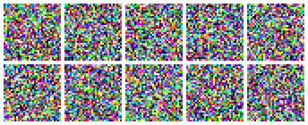

# Mini DDPM — Kelompok 11

Implementasi **Denoising Diffusion Probabilistic Model (DDPM)** skala kecil *from scratch* dengan PyTorch:
**class-conditional + classifier-free guidance (CFG)**, dilatih pada **MNIST** (uji kebenaran) dan **CIFAR-10** (dataset utama) di resolusi 32×32 pada laptop (RTX 4050 Laptop 6 GB).

Proyek 1 mata kuliah CAK4KBB3 2026-1 — *Vibe Coding & Generative AI from Scratch*, dikerjakan bersama **Claude Code (Opus 5.5)**.

| Nama | NIM | Peran |
|---|---|---|
| Naufal Rafif Hidayat | 103012300403 | Prompt Engineer & LLM Navigator (Ketua) |
| Ardhian Calwa Nugraha | 103012300404 | Data Pipeline & Preprocessing Engineer |
| Ali Hizqil Syauqani | 103012300036 | Training Loop & Hyperparameter Tuning Engineer |
| Muhammad Akhdan Ghifari | 103012300148 | Lead Documentarian & Error Handler |




## Hasil utama

| | MNIST | CIFAR-10 |
|---|---|---|
| Parameter U-Net | 1,62 juta | 8,95 juta |
| Training | 20 epoch (±27 menit) | 100 epoch (±3,8 jam) |
| Loss akhir (MSE noise) | 0,0167 | 0,0302 |
| FID (5.000 sampel, DDIM-100) | — | **16,43** (guidance w = 2) |

- Guidance sweep CIFAR-10 (FID): w = 0 / 1 / **2** / 3 / 5 → 26,52 / 22,70 / **16,43** / 18,01 / 26,30.
- Eksperimen epoch 30 (FID, w = 3): batch 64 **23,37** · baseline 31,00 · lr 1e-4 34,08 · lr 4e-4 35,00 · cosine 45,26.
- DDIM-100 vs DDPM-1000: FID setara (26,23 vs 26,64 pada 2.000 sampel), DDIM ±10× lebih cepat.

Analisis lengkap: [`reports/eksperimen.md`](reports/eksperimen.md) · laporan: [`reports/laporan_akhir.md`](reports/laporan_akhir.md).

## Setup (Windows, PowerShell)

Prasyarat: Python 3.11, Git, GPU NVIDIA dengan driver yang mendukung CUDA 13.0 (opsional — tanpa GPU kode tetap jalan di CPU, tetapi training sangat lambat).

```powershell
git clone https://github.com/shortahairlover/ddpm-kelompok11.git
cd ddpm-kelompok11
py -3.11 -m venv .venv
.venv\Scripts\activate
python -m pip install --upgrade pip
pip install -r requirements.txt     # termasuk torch 2.14.1 + torchvision 0.29.1 build CUDA 13.0
python scripts/check_env.py         # harus berakhir dengan "SEMUA CEK LOLOS"
```

MNIST (±12 MB) dan CIFAR-10 (±170 MB) diunduh otomatis ke `data/` saat pertama kali dipakai.

> **Windows:** clone ke folder dengan path pendek (misal `D:\proyek\ddpm-kelompok11`). Path yang terlalu dalam membuat `pip install` gagal dengan `OSError: [WinError 206] The filename or extension is too long` karena batas 260 karakter (MAX_PATH) — ditemukan saat uji reproduksi Fase 8.

### Checkpoint terbaik
Checkpoint tidak di-commit (ukuran besar). Unduh dari halaman **Releases** repo ini (rilis `v1.0`):

| Berkas | Isi | Letakkan di |
|---|---|---|
| `cifar10_e1_epoch100.pt` (±69 MB) | E1 baseline epoch 100, bobot model + EMA (FID 16,43 dengan w = 2) | `runs/e1_baseline_20261022-160411/checkpoints/epoch_100.pt` |
| `mnist_epoch020.pt` (±13 MB) | MNIST sanity run epoch 20 | `runs/mnist_sanity_20261022-152956/checkpoints/epoch_020.pt` |

Dengan path tersebut, `python -m scripts.demo` langsung menemukan checkpoint-nya; atau pakai `--ckpt <path>` di mana pun berkas disimpan.

## Cara menjalankan

Semua perintah dijalankan dari root repo dengan venv aktif.

| Tujuan | Perintah |
|---|---|
| Uji cepat seluruh pipeline (±30 detik) | `python -m src.train --config configs/mnist.yaml --debug` |
| Training MNIST | `python -m src.train --config configs/mnist.yaml` |
| Training CIFAR-10 (baseline) | `python -m src.train --config configs/cifar10.yaml` |
| Melanjutkan training | `python -m src.train --resume runs/<nama_run> [--epochs 120]` |
| Override hyperparameter | `python -m src.train --config configs/cifar10.yaml --set train.lr=1e-4 --name coba` |
| Eksperimen E2–E5 berurutan | `powershell -ExecutionPolicy Bypass -File scripts\run_experiments.ps1` |
| Generate grid per kelas | `python -m src.sample --ckpt runs/<run>/checkpoints/epoch_100.pt --guidance 0 2 5` |
| Strip proses denoising | `python -m src.sample --ckpt <ckpt> --frames` |
| FID | `python -m src.evaluate --ckpt <ckpt> --guidance 2` (atau `scripts\run_fid.ps1`) |
| **Demo presentasi** | `python -m scripts.demo --kelas cat dog horse` (±3 detik) |
| GIF denoising | `python -m scripts.make_gif --ckpt <ckpt> --out reports/figures/x.gif` |
| Grafik loss / FID | `python -m scripts.plot_metrics runs/<run> --out x.png` · `python -m scripts.plot_fid` |
| Benchmark kecepatan & VRAM | `python -m scripts.benchmark_step --config configs/cifar10.yaml` |

Setiap run tersimpan di `runs/<nama>_<waktu>/`: `config.yaml`, `train.log`, `metrics.csv`, `steps.csv`, `tensorboard/`, `samples/`, `checkpoints/` (`epoch_XXX.pt` + `last.pt`). Lihat kurva dengan `tensorboard --logdir runs`.

> Checkpoint terbaik tersedia di Releases (lihat bagian *Checkpoint terbaik* di atas).

## Struktur

| Path | Isi |
|---|---|
| `configs/` | Hyperparameter YAML (`mnist.yaml`, `cifar10.yaml`, `experiments/e2–e5`) |
| `src/data.py` | Dataset, transform ([-1, 1]), dataloader |
| `src/schedule.py` | Noise schedule linear/cosine + konstanta posterior |
| `src/model.py` | U-Net: embedding waktu & kelas, ResBlock, self-attention |
| `src/diffusion.py` | Forward process, loss, sampling DDPM & DDIM, classifier-free guidance |
| `src/ema.py`, `src/train.py`, `src/sample.py`, `src/evaluate.py` | EMA, training loop, sampling, FID |
| `scripts/` | Cek lingkungan, visualisasi, eksperimen, FID, GIF, demo, konversi transkrip |
| `tests/` | `pytest` (data, schedule, model, diffusion, DDIM, training end-to-end, FID utils) |
| `logs/` | Log Interaksi LLM per fase + transkrip sesi ([indeks](logs/README.md)) |
| `audits/` | Laporan audit tiap fase (0 error/bug sebelum merge) |
| `reports/` | Gambar, tabel eksperimen, FID, laporan akhir, slide |

## Pengembangan

```powershell
ruff check .          # lint
python -m pytest      # semua test (±1 menit, butuh dataset & GPU untuk sebagian test)
```

Rencana kerja dan aturan lengkap ada di [`PLANNING.md`](PLANNING.md); aturan untuk LLM ada di [`CLAUDE.md`](CLAUDE.md).
