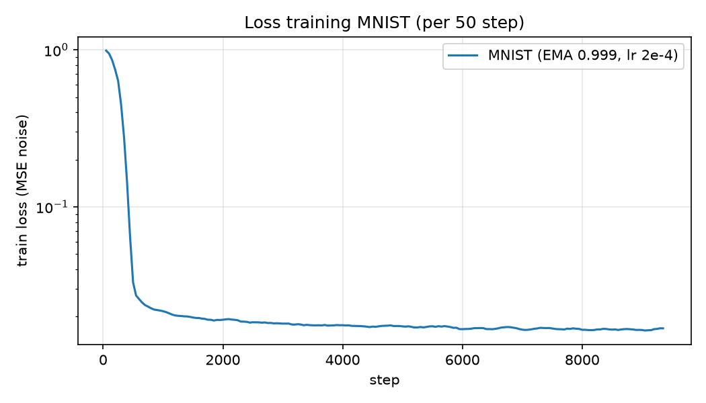
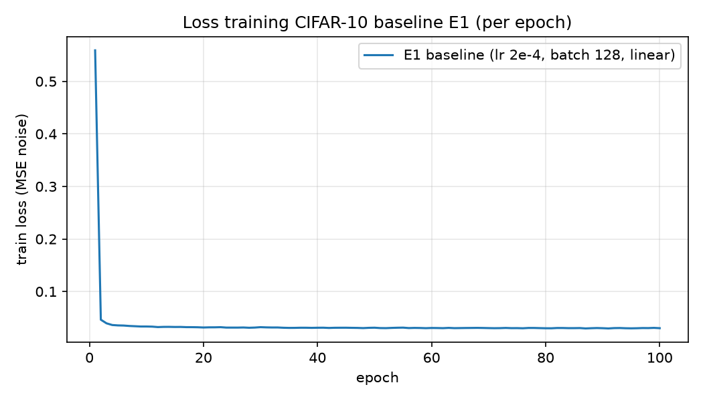
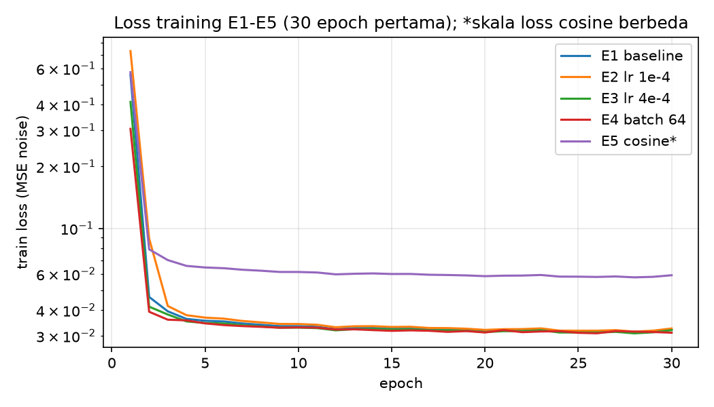
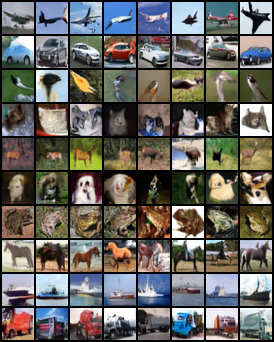
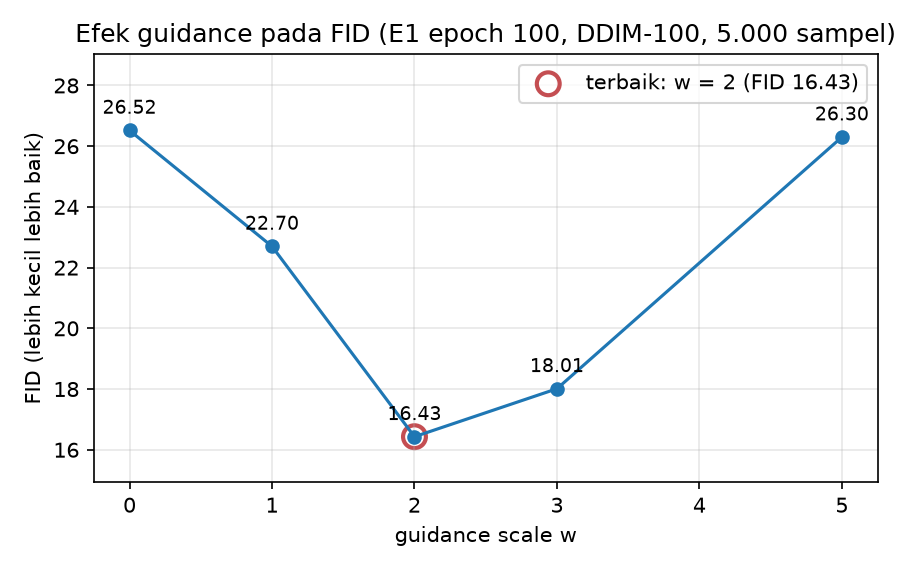
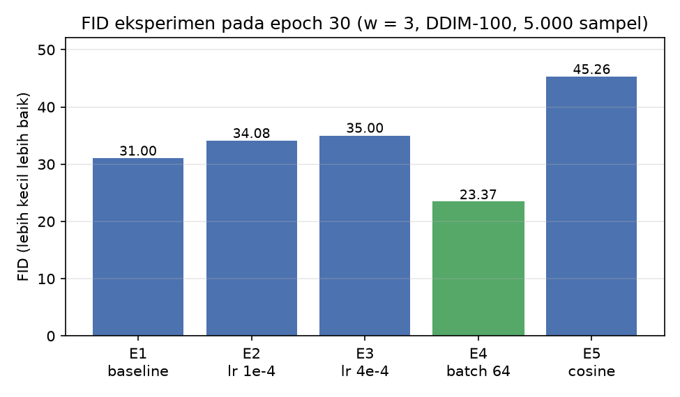

# Laporan Akhir Proyek 1 — Mini Diffusion Model (DDPM) Class-Conditional

**Mata kuliah:** CAK4KBB3 2026-1 — *Vibe Coding & Generative AI from Scratch*  
**Kelompok 11** · **LLM:** Claude Code (Opus 5.5) · **Repositori:** `github.com/shortahairlover/ddpm-kelompok11` (private)

| Nama | NIM | Peran |
|---|---|---|
| Naufal Rafif Hidayat | 103012300403 | Anggota 1 — Prompt Engineer & LLM Navigator (Ketua) |
| Ardhian Calwa Nugraha | 103012300404 | Anggota 2 — Data Pipeline & Preprocessing Engineer |
| Ali Hizqil Syauqani | 103012300036 | Anggota 3 — Training Loop & Hyperparameter Tuning Engineer |
| Muhammad Akhdan Ghifari | 103012300148 | Anggota 4 — Lead Documentarian & Error Handler |

---

## 1. Pendahuluan & Tujuan

Model difusi adalah keluarga model generatif yang belajar **membalik proses penambahan noise**: gambar asli dirusak perlahan menjadi noise Gaussian, lalu sebuah jaringan dilatih untuk menghapus noise itu langkah demi langkah. Proyek ini membangun **DDPM** (Ho dkk., 2020) dari nol dengan PyTorch, tanpa library difusi siap pakai, dan memperluasnya menjadi **class-conditional** dengan **classifier-free guidance** (Ho & Salimans, 2022) sehingga kelas gambar yang dihasilkan bisa dipilih.

Tujuan:

1. Mengimplementasikan seluruh komponen DDPM *from scratch*: noise schedule, forward process, U-Net dengan embedding waktu & kelas, loss, dan sampling.
2. Membuktikan kebenaran pipeline pada **MNIST**, lalu melatih model utama pada **CIFAR-10** (32×32, 10 kelas) di laptop dengan GPU 6 GB.
3. Melakukan eksperimen hyperparameter dan mengevaluasi kualitas secara kuantitatif (**FID**) dan visual.
4. Mendokumentasikan seluruh proses kolaborasi dengan LLM (*vibe coding*).

## 2. Teori Singkat

**Forward process.** Dengan jadwal β₁…β_T (T = 1000, linear 1e-4 → 0,02), αₜ = 1 − βₜ dan ᾱₜ = ∏ αₛ, gambar bernoise dapat diambil langsung:
x_t = √ᾱₜ · x₀ + √(1 − ᾱₜ) · ε, dengan ε ~ N(0, I).

**Objektif training.** Jaringan ε_θ(x_t, t, y) dilatih memprediksi noise yang ditambahkan: L = ‖ε − ε_θ(x_t, t, y)‖². Memprediksi noise (bukan gambar) memberi target yang skalanya sama di semua t sehingga training stabil.

**Reverse process (sampling DDPM).** Dari x_T ~ N(0, I), setiap langkah memperkirakan x̂₀ = (x_t − √(1−ᾱₜ) ε_θ)/√ᾱₜ (di-clamp ke [−1, 1]), lalu mengambil x_{t−1} dari posterior q(x_{t−1} | x_t, x̂₀) dengan mean μ = c₁x̂₀ + c₂x_t dan varians β̃ₜ = βₜ(1−ᾱ_{t−1})/(1−ᾱₜ). Tidak ada noise ditambahkan pada langkah terakhir.

**Classifier-free guidance.** Saat training, label diganti token "null" dengan peluang 10 %, sehingga satu jaringan belajar versi kondisional dan tanpa kondisi. Saat sampling: ε = ε_uncond + w · (ε_cond − ε_uncond). w = 0 → tanpa kondisi, w = 1 → kondisional murni, w > 1 → kelas diperkuat (kualitas naik, keragaman turun).

**DDIM.** Sampler deterministik (Song dkk., 2021) yang memakai model yang sama tetapi melompati timestep (100 dari 1000 langkah). Dengan η = 1 dan seluruh 1000 langkah, DDIM secara aljabar identik dengan DDPM — fakta ini kami uji secara otomatis.

## 3. Metodologi Vibe Coding

- **System prompt kelompok** ditulis di [`CLAUDE.md`](../CLAUDE.md) dan dibaca otomatis Claude Code di setiap sesi: aturan *from scratch* (dilarang `diffusers`/bobot pretrained generatif/menyalin tutorial), konvensi data ([-1, 1], 32×32, token null = 10), semua hyperparameter dari YAML, komentar shape tensor di setiap fungsi.
- **Konteks & scope** di [`PLANNING.md`](../PLANNING.md): 9 fase, ±80 task bernomor, keputusan teknis yang dikunci, dan catatan perubahan (Bagian H).
- **Protokol running** (arahan kelompok): seluruh fase dijalankan berurutan tanpa berhenti; **satu branch per fase**; setiap task di-commit hanya bila verifikasinya lolos; sebelum pindah fase dilakukan **audit 9 poin** (kelengkapan task, `ruff`, `pytest`, kriteria selesai, smoke test, scope, review kode, kebersihan repo, dokumentasi) sampai **0 error / 0 bug**, baru push → Pull Request → merge ke `main`. Bukti: [`audits/`](../audits/) dan PR #1–#9.
- **Log Interaksi** per fase di [`logs/interaksi/`](../logs/interaksi/) mengikuti template dosen, ditambah transkrip lengkap di [`logs/raw/`](../logs/raw/) (indeks: [`logs/README.md`](../logs/README.md)).
- **Variasi prompt:** meminta rekomendasi & perbandingan opsi, meminta rencana bertahap, memberi batasan proses (audit, branch, tanpa berhenti), meminta revisi rencana, memberi data (identitas, NIM), meminta penjelasan langkah (cara login), dan pertanyaan klarifikasi.

## 4. Data Pipeline

| Item | MNIST | CIFAR-10 |
|---|---|---|
| Sumber | `torchvision.datasets.MNIST` (unduh otomatis) | `torchvision.datasets.CIFAR10` (unduh otomatis) |
| Jumlah train / test | 60.000 / 10.000 | 50.000 / 10.000 |
| Ukuran input | 1×28×28 → **pad 2 px → 1×32×32** | 3×32×32 |
| Augmentasi | tidak ada (angka tidak boleh di-flip) | random horizontal flip (train) |
| Normalisasi | `ToTensor` + `Normalize(0.5, 0.5)` → **[−1, 1]** | sama |

`Normalize(0.5, 0.5)` dipakai (bukan `Lambda(x*2−1)`) karena worker DataLoader di Windows memakai *spawn* sehingga transform harus bisa di-pickle. Mode `--debug` memakai subset 512 gambar tetap (seed) untuk uji cepat. Bukti: `reports/figures/batch_mnist.png`, `batch_cifar10.png`, 11 test data.

## 5. Arsitektur Model

U-Net (`src/model.py`) memprediksi ε dari (x_t, t, y):

```
x_t (B,C,32,32) ─ conv_in ─┬─ [ResBlock×2]  32×32 ─────────────────────────┐ skip
                           ├─ Down → [ResBlock+Attn×2] 16×16 ─────────────┐ │
                           ├─ Down → [ResBlock×2]  8×8 ─────────────────┐ │ │
                           └─ Down → [ResBlock×2]  4×4  (khusus CIFAR)  │ │ │
                                   Bottleneck: ResBlock → Attention → ResBlock
                           ┌─ [ResBlock×3] + Up ◄──── concat skip ──────┘ │ │
                           ├─ [ResBlock+Attn×3] + Up ◄────────────────────┘ │
                           └─ [ResBlock×3] ◄───────────────────────────────┘
                              GroupNorm → SiLU → conv_out ─► ε̂ (B,C,32,32)
emb = MLP(sinusoidal(t)) + Embedding(y ∈ {0..9, null=10})  → disuntikkan ke setiap ResBlock
```

- **ResBlock:** GroupNorm → SiLU → Conv3×3, + proyeksi embedding per channel, GroupNorm → SiLU → Dropout → Conv3×3 (diinisialisasi nol sehingga blok mulai sebagai identitas), skip 1×1 bila channel berubah.
- **Self-attention multi-head (4 head)** ditulis manual dengan `einsum` + softmax pada resolusi 16×16 dan bottleneck.
- **Konfigurasi:** MNIST base 32, mult (1, 2, 2) → **1,62 juta parameter**; CIFAR-10 base 64, mult (1, 2, 2, 2), dropout 0,1 → **8,95 juta parameter**.

## 6. Training & Eksperimen

**Pengaturan:** AdamW lr 2e-4 (warmup linear), batch 128, grad clip 1,0, **AMP fp16**, **EMA** (0,999 MNIST / 0,9999 CIFAR-10), label dropout 10 %, checkpoint atomik + `--resume`, logging CSV + TensorBoard. Benchmark CIFAR-10: ±290 ms/step, ±1,9 menit/epoch, VRAM puncak 3,7 GB.

**Uji kebenaran:** tes overfit 1 batch — loss 1,0 → **0,0001** (t & noise tetap) dan turun 95,5 % (t & noise acak); `reports/figures/overfit_one_batch.png`.

| Run | Data | Epoch | Waktu | Loss akhir |
|---|---|---|---|---|
| MNIST sanity | MNIST | 20 | ±27 menit | 0,0167 |
| **E1 baseline** | CIFAR-10 | 100 | ±3,8 jam | 0,0302 |
| E2 lr 1e-4 | CIFAR-10 | 30 | ±70 menit | 0,0325 |
| E3 lr 4e-4 | CIFAR-10 | 30 | ±72 menit | 0,0320 |
| E4 batch 64 | CIFAR-10 | 30 | ±79 menit | 0,0310 |
| E5 cosine | CIFAR-10 | 30 | ±70 menit | 0,0591* |

\* skala loss schedule cosine tidak sebanding dengan linear.





## 7. Hasil

### 7.1 Kualitatif
- **MNIST** (`figures/mnist_grid_final.png`): setiap baris berisi angka sesuai label 0–9 dengan gaya tulisan bervariasi.
- **CIFAR-10** (`figures/cifar10_final_w2.png`): setiap baris jelas sesuai kelas (airplane … truck); bentuk dan warna meyakinkan, detail halus masih buram — wajar untuk model 9 juta parameter pada 32×32.
- **Progres** (`figures/progress_cifar10_e1.png`): bentuk kelas sudah muncul di epoch 10, detail & kontras membaik sampai epoch 100.
- **GIF denoising**: `figures/denoise_cifar10.gif`, `figures/denoise_mnist.gif`.
- **EMA vs non-EMA** (`figures/s2_ema_vs_raw.png`): sampel EMA jelas lebih halus dan bersih.



### 7.2 Kuantitatif (FID)
FID dihitung dengan Inception-v3 (torchmetrics) terhadap 50.000 gambar train CIFAR-10, 5.000 sampel berlabel seimbang, bobot EMA, sampler DDIM-100. Angka FID 5k lebih tinggi daripada FID 50k di paper; dipakai untuk **membandingkan** eksperimen.

| Perbandingan | Hasil (FID ↓) |
|---|---|
| Epoch 30, w = 3 | **E4 batch 64: 23,37** · E1: 31,00 · E2 lr 1e-4: 34,08 · E3 lr 4e-4: 35,00 · E5 cosine: 45,26 |
| Guidance (E1 epoch 100) | w = 0: 26,52 · w = 1: 22,70 · **w = 2: 16,43** · w = 3: 18,01 · w = 5: 26,30 |
| Sampler (2.000 sampel) | DDIM-100: 26,23 (8,9 menit) · DDPM-1000: 26,64 (85,7 menit) |




**Model terbaik: E1 epoch 100, EMA, w = 2 → FID 16,43.**

### 7.3 Analisis
1. **Guidance berbentuk U:** guidance terlalu kecil membuat kelas kurang tegas, terlalu besar membuat warna jenuh dan variasi berkurang — trade-off kualitas–keragaman CFG; optimum di w = 2.
2. **Learning rate 2e-4 adalah titik tengah terbaik.** lr 4e-4 punya loss training sedikit lebih kecil tetapi FID lebih buruk → loss training bukan ukuran kualitas sampel.
3. **Batch 64 terbaik per epoch** karena melakukan 2× jumlah update dengan VRAM ±separuh; pada jumlah update setara keunggulan ini belum tentu bertahan.
4. **Schedule cosine terburuk** pada CIFAR-10 32×32 dalam 30 epoch; schedule linear DDPM asli sudah cocok untuk resolusi ini.
5. **DDIM-100 ≈ DDPM-1000** dalam FID, 10× lebih cepat — memungkinkan evaluasi lengkap dan demo real-time (12 gambar dalam ±2,5 detik).

## 8. Analisis Eror & Pelajaran Debugging

| Fase | Eror / masalah | Analisis & solusi |
|---|---|---|
| 0 | `Failed to connect to github.com:443` | Jaringan memblokir GitHub (PyPI bisa); setelah jaringan normal, `gh auth login` oleh kelompok |
| 1 | `unexpected EOF while looking for matching '` | Heredoc bersarang di satu perintah shell → file ditulis terpisah |
| 1 | Override `train.lr=1e-4` terbaca **string** | PyYAML 1.1 hanya mengenali `1.0e-4` → fungsi `_parse_value` + test tipe |
| 2 | Risiko `Can't pickle <lambda>` di worker Windows | `Normalize(0.5, 0.5)` menggantikan `Lambda`; diuji dengan 2 worker |
| 3 | Test `q_sample` t = 0 gagal | Toleransi test salah (√(1−ᾱ₀)·ε bisa ±0,04) → toleransi diturunkan dari rumus |
| 3 | Gradien nol pada model baru | Efek init nol yang disengaja → test gradien mengacak bobot dulu |
| 5 | Log UTF-16 & risiko rantai eksperimen berhenti karena stderr | PowerShell 5.1: `Continue` + `$LASTEXITCODE` + `Out-File utf8`; jalur gagal diuji |
| 6 | FID DDPM ±20 jam | Sampler DDIM + test kesetaraan DDPM + pembanding |
| 6 | VRAM 5,9 GB saat FID | Pekerjaan lain dipindah ke CPU |
| 6 | Path absolut di CSV | `display_path` + CSV dikeluarkan dari commit yang belum di-push |
| 7 | Konverter transkrip melabeli notifikasi sistem sebagai prompt & menghilangkan pesan Claude | Label berdasarkan `origin.kind == "human"`, urutan cabang diperbaiki, test regresi |

**Pelajaran:** (1) uji kebenaran kecil (overfit 1 batch, MNIST) sebelum training mahal; (2) toleransi numerik test harus diturunkan dari matematika; (3) loss training tidak sama dengan kualitas sampel — butuh FID; (4) skrip otomasi harus dites jalur gagalnya; (5) audit sebelum merge menangkap masalah yang lolos dari test (kode mati, path absolut, data pribadi).

## 9. Pembagian Peran & Integrasi

Pembagian peran formal mengikuti panduan (tabel di awal). Atas keputusan kelompok, seluruh task dieksekusi oleh Claude Code berdasarkan arahan, prompt, dan keputusan kelompok (ketua memberi perintah, identitas Git, login GitHub, dan persetujuan perubahan rencana). Integrasi antar bagian terlihat pada:

- **9 branch fase** dan **Pull Request #1–#9** yang masing-masing berisi ringkasan dan hasil audit;
- commit per task berawalan ID task (`T2.3: ...`) sehingga setiap komponen dapat ditelusuri ke task di `PLANNING.md`;
- **test regresi** yang menggabungkan seluruh modul (data → model → diffusion → training → sampling → evaluasi): seluruh 75 test lolos di akhir proyek (juga lolos di clone bersih saat uji reproduksi Fase 8).

## 10. Keterbatasan & Pengembangan Lanjut
- Resolusi 32×32 dan model 9 juta parameter → detail halus masih buram; model lebih besar / training lebih lama akan menurunkan FID.
- FID dihitung dengan 5.000 sampel dan DDIM-100 (bias ke atas; hanya untuk perbandingan internal).
- Perbandingan E1–E5 pada 30 epoch dengan satu seed; variasi antar-seed belum diukur.
- Pengembangan: prediksi v / ε-hybrid, schedule sampling yang lebih efisien, *learned variance*, resolusi 64×64, dataset lain (mis. batik Indonesia).

## 11. Lampiran
- Log Interaksi per fase: [`logs/interaksi/`](../logs/interaksi/) · indeks: [`logs/README.md`](../logs/README.md)
- Transkrip sesi Claude Code: [`logs/raw/`](../logs/raw/)
- Laporan audit fase: [`audits/`](../audits/)
- Tabel eksperimen & FID lengkap: [`reports/eksperimen.md`](eksperimen.md), [`reports/fid_results.csv`](fid_results.csv)
- Rencana kerja: [`PLANNING.md`](../PLANNING.md) · System prompt: [`CLAUDE.md`](../CLAUDE.md)

### Referensi
1. Ho, J., Jain, A., & Abbeel, P. (2020). *Denoising Diffusion Probabilistic Models.* NeurIPS.
2. Ho, J., & Salimans, T. (2022). *Classifier-Free Diffusion Guidance.* arXiv:2207.12598.
3. Song, J., Meng, C., & Ermon, S. (2021). *Denoising Diffusion Implicit Models.* ICLR.
4. Nichol, A., & Dhariwal, P. (2021). *Improved Denoising Diffusion Probabilistic Models.* ICML.
5. Heusel, M. dkk. (2017). *GANs Trained by a Two Time-Scale Update Rule Converge to a Local Nash Equilibrium* (FID). NeurIPS.
