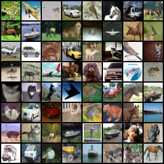
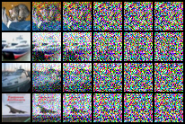
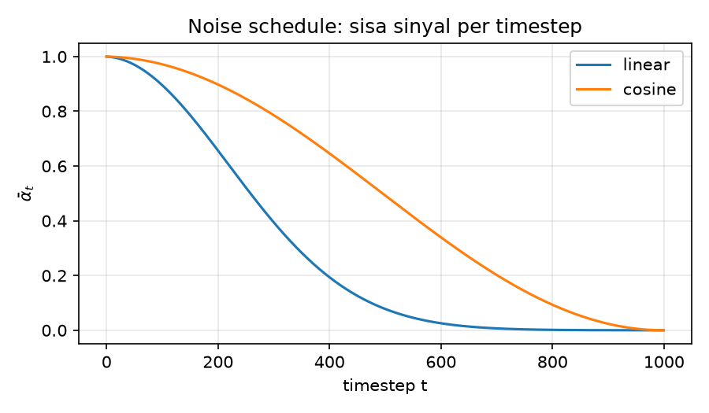
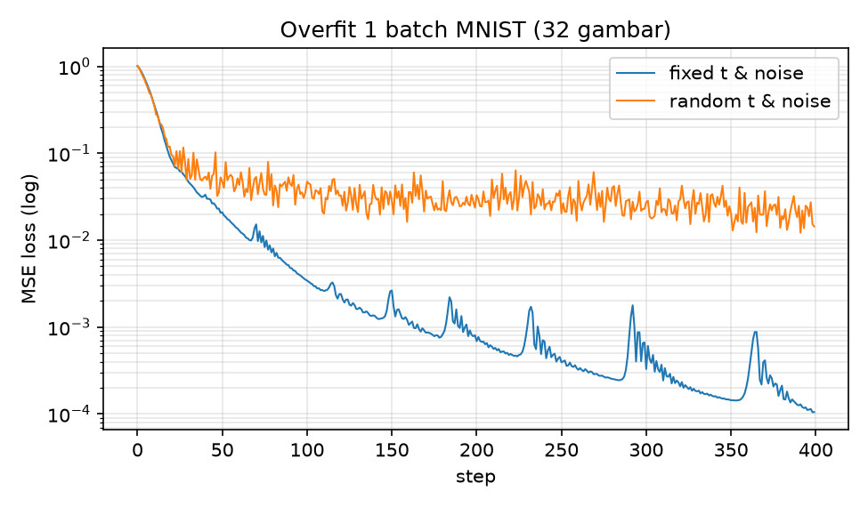
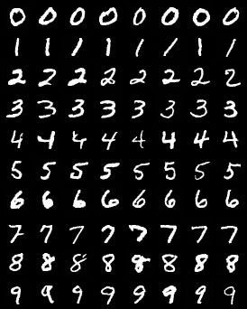
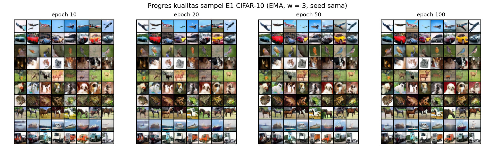
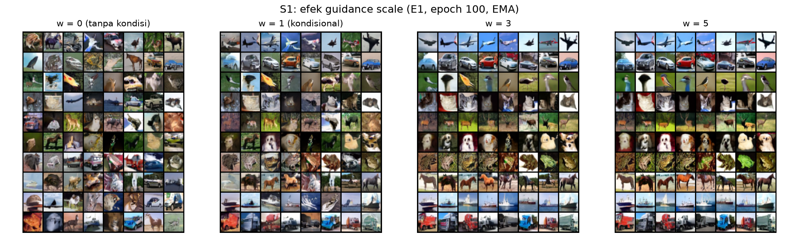
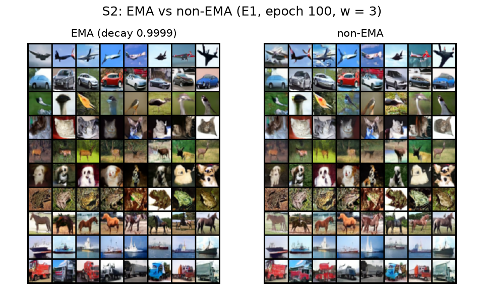

LAPORAN AKHIR PROYEK 1

<h1 class="cover-title">Mini Diffusion Model (DDPM) Class-Conditional dengan Classifier-Free Guidance</h1>

Vibe Coding &amp; Generative AI from Scratch — CAK4KBB3 2026-1

KELOMPOK 11

<table class="cover-table">
<tr><th>Nama</th><th>NIM</th><th>Peran</th></tr>
<tr><td>Naufal Rafif Hidayat</td><td>103012300403</td><td>Anggota 1 — Prompt Engineer &amp; LLM Navigator (Ketua)</td></tr>
<tr><td>Ardhian Calwa Nugraha</td><td>103012300404</td><td>Anggota 2 — Data Pipeline &amp; Preprocessing Engineer</td></tr>
<tr><td>Ali Hizqil Syauqani</td><td>103012300036</td><td>Anggota 3 — Training Loop &amp; Hyperparameter Tuning Engineer</td></tr>
<tr><td>Muhammad Akhdan Ghifari</td><td>103012300148</td><td>Anggota 4 — Lead Documentarian &amp; Error Handler</td></tr>
</table>
<table class="cover-links">
<tr><th>LLM</th><td>Claude Code (Opus 5.5)</td></tr>
<tr><th>Repositori GitHub</th><td><a href="https://github.com/shortahairlover/ddpm-kelompok11">https://github.com/shortahairlover/ddpm-kelompok11</a></td></tr>
<tr><th>Video rekaman sesi LLM</th><td><a href="https://drive.google.com/file/d/1E0mxh4NyOpxSEMkvtAFty0co71eUUVX3/view?usp=sharing">https://drive.google.com/file/d/1E0mxh4NyOpxSEMkvtAFty0co71eUUVX3/view?usp=sharing</a></td></tr>
<tr><th>Transkrip chat LLM (Markdown)</th><td><a href="https://github.com/shortahairlover/ddpm-kelompok11/tree/main/logs/raw">github.com/shortahairlover/ddpm-kelompok11/tree/main/logs/raw</a></td></tr>
<tr><th>Checkpoint model</th><td><a href="https://github.com/shortahairlover/ddpm-kelompok11/releases/tag/v1.0">Release v1.0</a></td></tr>
</table>

## Ringkasan

Kelompok 11 membangun **Mini Diffusion Model (DDPM)** dari nol dengan PyTorch, diperluas menjadi **class-conditional dengan classifier-free guidance (CFG)** sehingga kelas gambar yang dihasilkan dapat dipilih. Seluruh kode dibangun dengan metode **vibe coding** bersama **Claude Code (Opus 5.5)** — tanpa menyalin tutorial dan tanpa library difusi siap pakai — dan dijalankan pada laptop dengan GPU **NVIDIA RTX 4050 Laptop 6 GB**.

| Hasil utama | Nilai |
|---|---|
| Uji kebenaran (MNIST, 20 epoch) | Angka 0–9 tergenerate **sesuai label**; loss akhir 0,0167 |
| Model utama (CIFAR-10, 100 epoch, ±3,8 jam) | 10 kelas dikenali jelas; loss akhir 0,0302 |
| Kualitas terbaik (FID, makin kecil makin baik) | **16,43** (guidance w = 2, 5.000 sampel) |
| Eksperimen fine-tuning hyperparameter | 4 eksperimen (lr, batch size, noise schedule) + guidance + EMA + sampler |
| Kualitas kode | 3.955 baris Python, **75 test otomatis lolos**, lint bersih, dapat direproduksi dari clone bersih |
| Integrasi tim | 9 branch fase, **9 Pull Request**, 38 commit, 9 laporan audit (0 error / 0 bug sebelum merge) |
| Dokumentasi LLM | Log Interaksi per fase sesuai template + transkrip lengkap + video rekaman sesi |

## 1. Pendahuluan

### 1.1 Latar belakang
Panduan proyek menawarkan **Mini Diffusion Model (DDPM)** sebagai salah satu pilihan *Generative Image & Computer Vision*, dengan tantangan utama **menyusun noise schedule dan timestep embedding**. Model difusi (Ho dkk., 2020) belajar **membalik proses penambahan noise**: gambar asli dirusak bertahap menjadi noise Gaussian, lalu jaringan saraf dilatih menghapus noise tersebut langkah demi langkah. Untuk membuat gambar baru, model mulai dari noise murni.

### 1.2 Alasan pemilihan model
Model dipilih bersama LLM setelah membaca Panduan dan Daftar Kelompok: algoritma lain sudah diambil kelompok lain (U-Net, Mini GPT, Conditional GAN Fashion-MNIST), DDPM termasuk model terkini (2020), dan berukuran cukup kecil untuk dilatih pada GPU laptop. Varian **class-conditional** ditambahkan agar keluaran dapat dikontrol per kelas dan berbeda dari CGAN kelompok lain.

### 1.3 Tujuan
1. Mengimplementasikan seluruh komponen DDPM *from scratch*: noise schedule, forward process, U-Net dengan **timestep embedding** & class embedding, loss, dan sampling.
2. Membuktikan kebenaran pipeline pada **MNIST**, lalu melatih model utama pada **CIFAR-10** (32×32, 10 kelas).
3. Melakukan **eksperimen fine-tuning hyperparameter** dan mengevaluasi hasil secara kuantitatif (FID) serta visual.
4. Mendokumentasikan seluruh kolaborasi dengan LLM dalam **Log Interaksi** sesuai template Panduan.

## 2. Pembagian Tugas (Job Desk)

Pembagian peran mengikuti bagian 2 Panduan. Setiap peran memiliki keluaran yang dapat ditelusuri di repositori.

| Anggota | Tanggung jawab (Panduan) | Keluaran & bukti di repositori |
|---|---|---|
| **Naufal Rafif Hidayat** — Prompt Engineer & LLM Navigator (Ketua) | Merancang system prompt awal, mengomunikasikan kebutuhan arsitektur, menjaga konsistensi logika kode | `CLAUDE.md` (system prompt), `PLANNING.md` (82 task, keputusan teknis, protokol), arsitektur `src/model.py`, `src/schedule.py`, `src/diffusion.py`; seluruh prompt arahan & persetujuan protokol (audit, branch per fase) |
| **Ardhian Calwa Nugraha** — Data Pipeline & Preprocessing | Menyiapkan dataset, augmentasi, normalisasi, data loader, memastikan *shape* sesuai arsitektur | `src/data.py`, `scripts/show_batch.py`, `tests/test_data.py` (11 test: shape, rentang [−1, 1], padding, flip), grid `batch_mnist.png` & `batch_cifar10.png` |
| **Ali Hizqil Syauqani** — Training Loop & Hyperparameter Tuning | Fungsi loss, training loop, eksperimen fine-tuning (lr, batch size), mencatat metrik | `src/train.py`, `src/ema.py`, `src/evaluate.py`, `configs/experiments/` (E2–E5), `scripts/run_experiments.ps1`, `reports/eksperimen.md`, `reports/fid_results.csv`, grafik loss & FID |
| **Muhammad Akhdan Ghifari** — Lead Documentarian & Error Handler | Mengompilasi Log Interaksi LLM, menangkap eror untuk prompt perbaikan, menyusun laporan | `logs/interaksi/00–08`, `logs/raw/` (transkrip), `audits/fase-0…8`, laporan ini, slide presentasi, `reports/latihan_tanya_jawab.md` |

**Catatan cara kerja:** atas keputusan kelompok, eksekusi teknis (menulis kode, menjalankan training, memperbaiki eror) dilakukan oleh Claude Code berdasarkan **arahan, prompt, data, dan persetujuan kelompok** — ketua memberi perintah dan identitas Git, melakukan login GitHub, serta menyetujui setiap perubahan rencana. Karena itu seluruh commit tercatat atas akun ketua (`shortahairlover`), sedangkan kontribusi per peran ditelusuri melalui pembagian modul dan task di `PLANNING.md`.

## 3. Metodologi Vibe Coding

### 3.1 System prompt dan konteks kerja
- **`CLAUDE.md`** — *system prompt* kelompok yang otomatis dibaca Claude Code di setiap sesi: aturan *from scratch* (dilarang `diffusers`, `denoising-diffusion-pytorch`, bobot pretrained generatif, dan menyalin tutorial/repo publik), konvensi data (32×32, nilai [−1, 1], token null = 10), konvensi difusi (T = 1000, prediksi noise ε, loss MSE), semua hyperparameter dari YAML, dan komentar *shape* tensor di setiap fungsi.
- **`PLANNING.md`** — konteks & scope: 9 fase, 82 task bernomor, keputusan teknis yang dikunci, catatan perubahan, dan protokol running.

### 3.2 Protokol kerja (arahan kelompok)
1. Satu **branch per fase** (`fase-0-persiapan-tools` … `fase-8-finalisasi`).
2. Setiap task di-commit hanya jika verifikasinya lolos (pesan commit berawalan ID task, misal `T2.3: ...`).
3. Sebelum pindah fase: **audit 9 poin** — kelengkapan task, `ruff` (lint), `pytest`, kriteria selesai fase, smoke test end-to-end, kepatuhan scope (tidak ada import library terlarang), review kode, kebersihan repo, dokumentasi — diulang sampai **0 error / 0 bug**.
4. Baru setelah lolos: push → Pull Request → merge ke `main`.

### 3.3 Variasi prompt kelompok
Rubrik menilai variasi prompt. Prompt kelompok yang dipakai (dikutip apa adanya, urut waktu):

| # | Tanggal | Jenis prompt | Prompt kelompok |
|---|---|---|---|
| 1 | 22/10/2026 | Eksplorasi & rekomendasi | "bacalah dokumen yang berada di folder ini, kelompok kita adalah [daftar anggota] . kira kira untuk pemilihan untuk project 1 nya enaknya gimana" |
| 2 | 22/10/2026 | Klarifikasi teknis (data) | "untuk Mini Diffusion Model (DDPM) training nya pakai data apa?" |
| 3 | 22/10/2026 | Perencanaan menyeluruh | "buatlah planning nya untuk mengerjakan project 1 Mini Diffusion Model (DDPM) ini menggunakan cifar-10 dan mnist, ini mengerjakan di lokal jadi buat planning dari awal (install software yang dibutuhin dll) sampai akhir selesai projectnya" |
| 4 | 22/10/2026 | Koreksi data & pertanyaan kapabilitas | "untuk akhdan nimnya 103012300148, ketua naufal rafif hidayat, update. dan untuk dataset nya apakah kamu bisa download atau harus kita?" |
| 5 | 22/10/2026 | Revisi rencana & batasan scope | "...kita ubah agar setiap fase itu tidak mencantumkan waktu dan PIC. planning juga harus lengkap... planning ini berfungsi sebagai konteks anda untuk mengerjakan task task agar tidak keluar dari scope. semua task harus di kerjakan dari anda" |
| 6 | 22/10/2026 | Protokol proses (Git, audit, quality gate) | "...pastikan anda sudah ter-connect dengan github... tolong anda buat branch nya juga untuk setiap fase... sebelum anda lanjut ke fase selanjutnya, tolong lakukan audit... jika ada error atau bug tolong langsung solve sebelum di commit dan push. anda baru bisa lanjut ke fase selanjutnya jika hasil audit menghasilkan 0 error atau bug dan sudah commit dan push di github." |
| 7 | 22/10/2026 | Pemberian data & perintah eksekusi | "shortahairlover, naufalraf21@gmail.com. mulai" |
| 8 | 22/10/2026 | Troubleshooting | "cara loginnya gimana" · (mengirim screenshot hasil login) · "generate code lagi" |
| 9 | 22/10/2026 | Verifikasi status | "apakah sudah? ini akan langsung menjalankan semua fase kan?" |
| 10 | 22/10/2026 | Pertanyaan administratif | "algoritma yang dibangun namanya apa tadi? untuk saya taruh di excel tugas" |
| 11 | 23/10/2026 | Permintaan penjelasan hasil | "berikan penjelasan singkat result dari laporan akhirnya, saya bingung mahaminnya" |
| 12 | 23/10/2026 | Analisis kritis | "buatkan rangkuman apa saja yang telah dilakukan beserta hasilnya, lakukan juga analisis apakah masih ada kekurangan mengenai algoritma yang dibuat" |
| 13 | 28/10/2026 | Dokumentasi akhir | "buatlah laporan akhir dalam pdf sesuai dengan intruksi yang ada di word" |

## 4. Implementasi

### 4.1 Lingkungan
Windows 11, Python 3.11, **PyTorch 2.14.1 + CUDA 13.0**, GPU RTX 4050 Laptop 6 GB. Diverifikasi dengan `scripts/check_env.py` (perkalian matriks GPU vs CPU dan satu langkah *mixed precision*). Instalasi dari `requirements.txt` diuji ulang dari clone GitHub bersih.

### 4.2 Data pipeline (Anggota 2)

| Item | MNIST | CIFAR-10 |
|---|---|---|
| Sumber | `torchvision.datasets.MNIST` (unduh otomatis) | `torchvision.datasets.CIFAR10` (unduh otomatis) |
| Jumlah train / test | 60.000 / 10.000 | 50.000 / 10.000 |
| Ukuran input | 1×28×28 → **pad 2 px → 1×32×32** | 3×32×32 |
| Augmentasi | tidak ada (angka tidak boleh dicerminkan) | random horizontal flip (saat training) |
| Normalisasi | `ToTensor` + `Normalize(0.5, 0.5)` → **[−1, 1]** | sama |

Normalisasi ke [−1, 1] menyamakan skala data dengan noise Gaussian. `Normalize(0.5, 0.5)` dipakai sebagai pengganti `Lambda(x*2−1)` karena worker DataLoader di Windows harus dapat mem-*pickle* transform.

### 4.3 Noise schedule & forward process (tantangan Panduan)
Jadwal β linear 1e-4 → 0,02 dengan **T = 1000** langkah; ᾱ_t = ∏(1 − β_s). Gambar bernoise diambil langsung dengan
**x_t = √ᾱ_t · x₀ + √(1 − ᾱ_t) · ε**, ε ~ N(0, I). Semua konstanta (termasuk koefisien posterior) dihitung dalam float64 agar ᾱ_t yang mendekati nol tetap akurat. Schedule **cosine** juga diimplementasikan untuk eksperimen.

### 4.4 Timestep embedding & arsitektur U-Net (tantangan Panduan)
- **Timestep embedding:** t diubah menjadi vektor sinusoidal (frekuensi geometrik 1 … 1/10000), lalu MLP (Linear → SiLU → Linear). Embedding ini memberi tahu jaringan *seberapa banyak noise* pada input.
- **Class embedding:** `Embedding(11, dim)` — kelas 0–9 + **token null (10)** untuk classifier-free guidance; dijumlahkan dengan embedding waktu lalu disuntikkan ke setiap ResBlock.
- **U-Net:** encoder (32→16→8→4) – bottleneck (ResBlock → self-attention → ResBlock) – decoder dengan *skip connection*. ResBlock: GroupNorm → SiLU → Conv; konvolusi terakhir diinisialisasi nol agar blok mulai sebagai identitas. **Self-attention 4 head ditulis manual** (einsum + softmax) pada resolusi 16×16.
- **Ukuran:** MNIST 1,62 juta parameter; CIFAR-10 **8,95 juta parameter**.

### 4.5 Loss, training loop, dan sampling (Anggota 3)
- **Loss:** MSE antara noise asli ε dan prediksi ε_θ(x_t, t, y), dengan t acak dan label diganti token null pada 10 % sampel.
- **Training loop:** AdamW (lr 2e-4, warmup linear), batch 128, *gradient clipping* 1,0, **mixed precision (AMP fp16)**, **EMA** bobot (0,999 MNIST / 0,9999 CIFAR-10), checkpoint atomik + `--resume`, logging CSV & TensorBoard.
- **Sampling DDPM:** 1000 langkah reverse dengan mean & varians posterior; x̂₀ di-clamp ke [−1, 1].
- **Classifier-free guidance:** ε = ε_uncond + w · (ε_cond − ε_uncond).
- **Sampling DDIM:** 100 langkah dengan model yang sama; diuji otomatis identik dengan DDPM bila η = 1 dan 1000 langkah.

### 4.6 Verifikasi kebenaran
**Tes overfit 1 batch** (32 gambar MNIST): loss turun dari 1,0 ke **0,0001** (t & noise tetap) dan turun 95,5 % (t & noise acak) — bukti model, loss, dan optimizer bekerja sebelum training panjang.

## 5. Training, Fine-Tuning Hyperparameter, dan Hasil

### 5.1 Uji kebenaran MNIST
20 epoch (9.360 step, ±27 menit): loss 0,356 → 0,0227 (epoch 2) → **0,0167** (epoch 20). Setiap baris sampel berisi angka **sesuai label** 0–9 dengan gaya tulisan bervariasi.

### 5.2 Model utama CIFAR-10 (E1 baseline)
100 epoch (39.000 step, ±3,8 jam, ±123 detik/epoch, VRAM puncak 3,7 GB): loss 0,559 → 0,046 (epoch 2) → **0,0302** (epoch 100). Kualitas sampel membaik bertahap sepanjang training.

### 5.3 Eksperimen fine-tuning hyperparameter
Setiap eksperimen mengubah **satu** variabel dari baseline (config mewarisi `configs/cifar10.yaml`), dilatih 30 epoch, dan dibandingkan dengan E1 pada epoch yang sama. Kualitas diukur dengan **FID** (Fréchet Inception Distance — jarak statistik fitur gambar buatan vs 50.000 gambar asli; **makin kecil makin baik**; 5.000 sampel, sampler DDIM-100, guidance w = 3).

| ID | Perubahan | Rata-rata loss epoch 26–30 | **FID ↓** | Waktu 30 epoch |
|---|---|---|---|---|
| E1 | Baseline (lr 2e-4, batch 128, linear) | 0,0315 | 31,00 | ±62 menit |
| E2 | lr 1e-4 | 0,0319 | 34,08 | ±63 menit |
| E3 | lr 4e-4 | 0,0313 | 35,00 | ±65 menit |
| **E4** | **batch 64** | 0,0312 | **23,37** | ±72 menit |
| E5 | cosine schedule | 0,0583* | 45,26 | ±63 menit |

\* skala loss schedule cosine berbeda sehingga tidak sebanding dengan schedule linear.

**Analisis:**

1. **Batch 64 terbaik per epoch** karena melakukan 2× jumlah update bobot, dengan VRAM ±separuh.
2. **Learning rate 2e-4 adalah titik tengah terbaik**: 1e-4 belajar terlalu lambat; 4e-4 memberi loss training sedikit lebih kecil tetapi FID lebih buruk — **loss training yang kecil tidak menjamin kualitas sampel**.
3. **Cosine schedule terburuk** untuk CIFAR-10 32×32 dalam 30 epoch; schedule linear DDPM asli sudah cocok untuk resolusi ini.

### 5.4 Guidance scale dan EMA

| Guidance w | 0 | 1 | **2** | 3 | 5 |
|---|---|---|---|---|---|
| FID ↓ (E1 epoch 100) | 26,52 | 22,70 | **16,43** | 18,01 | 26,30 |

Kurva berbentuk U: w kecil membuat kelas tidak tegas, w besar membuat warna jenuh dan variasi berkurang (*trade-off* kualitas–keragaman). **w = 2 terbaik.** EMA membuat sampel jelas lebih halus dibanding bobot non-EMA.

### 5.5 DDIM vs DDPM
Pada 2.000 sampel (w = 3): **DDIM-100 FID 26,23 (8,9 menit)** vs **DDPM-1000 FID 26,64 (85,7 menit)** — kualitas setara, ±10× lebih cepat. DDIM memungkinkan evaluasi lengkap dan demo langsung (12 gambar ±2,5 detik).

### 5.6 Luaran akhir
**Model terbaik: E1 epoch 100, bobot EMA, guidance w = 2 → FID 16,43.** Setiap baris berisi kelas yang diminta (airplane, automobile, bird, cat, deer, dog, frog, horse, ship, truck).

## 6. Log Interaksi LLM

Format mengikuti template bagian 5 Panduan. Log lengkap per fase (berisi cuplikan kode dan seluruh eror) ada di `logs/interaksi/00`–`08`; transkrip percakapan utuh ada di `logs/raw/`, dan video rekaman sesi di tautan pada sampul.

**Catatan prompt perbaikan:** kelompok menetapkan instruksi tetap untuk debugging (prompt #6): *"jika ada error atau bug tolong langsung solve sebelum di commit dan push"*. Karena itu sebagian besar eror dianalisis dan diperbaiki LLM langsung berdasarkan instruksi tersebut, lalu dicatat; eror yang membutuhkan tindakan kelompok (login GitHub) ditangani dengan prompt kelompok tersendiri.

**LOG INTERAKSI LLM — KELOMPOK 11 (#1)**

- **Tanggal Sesi:** 22/10/2026
- **Target Modul:** Pemilihan model & perencanaan proyek
- **Tautan Sesi Chat:** video rekaman (sampul) · `logs/raw/sesi_2026-10-22_s.d_2026-10-23_final.md`

**KRONOLOGI PROMPT & RESPONS:**

**1. TAHAP INISIASI**

- **Prompt Kelompok:** "bacalah dokumen yang berada di folder ini, kelompok kita adalah [daftar anggota]. kira kira untuk pemilihan untuk project 1 nya enaknya gimana" → "untuk Mini Diffusion Model (DDPM) training nya pakai data apa?" → "buatlah planning nya ... sampai akhir selesai projectnya"
- **Alasan Khusus:** meminta LLM membaca Panduan dan Daftar Kelompok terlebih dahulu agar rekomendasi mempertimbangkan algoritma yang sudah diambil kelompok lain dan spesifikasi laptop.
- **Output Model:** rekomendasi DDPM (beserta alternatif Pix2Pix, ViT, BERT), saran MNIST → CIFAR-10, lalu `PLANNING.md` 9 fase berisi scope, keputusan teknis, dan 82 task.

**2. TAHAP PENANGANAN EROR / DEBUGGING**

- **Pesan Eror:** — (tidak ada eror; tahap perencanaan). Revisi dilakukan lewat prompt #4–#6 (koreksi NIM & ketua, rencana tanpa PIC/waktu, protokol branch & audit).

**LOG INTERAKSI LLM — KELOMPOK 11 (#2)**

- **Tanggal Sesi:** 22/10/2026
- **Target Modul:** Fase 0 — Persiapan tools & koneksi GitHub
- **Tautan Sesi Chat:** video rekaman · `logs/interaksi/00_fase0_persiapan_tools.md`

**KRONOLOGI PROMPT & RESPONS:**

**1. TAHAP INISIASI**

- **Prompt Kelompok:** "update plan, untuk planning fase 0, pastikan anda sudah ter-connect dengan github, jika sudah tolong buatkan repository github untuk workspace ini..." lalu "shortahairlover, naufalraf21@gmail.com. mulai"
- **Alasan Khusus:** seluruh pekerjaan harus terlacak di GitHub dengan satu branch per fase.
- **Output Model:** instalasi GitHub CLI, repo private, venv Python 3.11, PyTorch 2.14.1 + CUDA 13.0, `scripts/check_env.py`.

**2. TAHAP PENANGANAN EROR / DEBUGGING**

- **Pesan Eror:** `fatal: unable to access 'https://github.com/git/git/': Failed to connect to github.com:443 after 21076 ms: Could not connect to server` dan setelah login di browser: `You are not logged into any GitHub hosts. To log in, run: gh auth login`
- **Prompt Perbaikan ke LLM:** "cara loginnya gimana" · (screenshot "Congratulations, you're all set!") · "generate code lagi"
- **Analisis & Solusi Kelompok:** koneksi gagal karena jaringan memblokir GitHub (PyPI tetap bisa); setelah jaringan normal, `gh auth login --web` dijalankan. Login tampak sukses di browser tetapi belum tersimpan karena gh baru mengambil token setelah **Enter** ditekan di terminal. **Pelajaran:** bedakan masalah jaringan dari konfigurasi, dan baca alur autentikasi perangkat sampai selesai.

**LOG INTERAKSI LLM — KELOMPOK 11 (#3)**

- **Tanggal Sesi:** 22/10/2026
- **Target Modul:** Fase 1 — Fondasi repo, system prompt, config YAML
- **Tautan Sesi Chat:** video rekaman · `logs/interaksi/01_fase1_fondasi.md`

**KRONOLOGI PROMPT & RESPONS:**

**1. TAHAP INISIASI**

- **Prompt Kelompok:** "planning ini berfungsi sebagai konteks anda untuk mengerjakan task task agar tidak keluar dari scope. semua task harus di kerjakan dari anda"
- **Alasan Khusus:** `CLAUDE.md` sebagai system prompt dan YAML sebagai satu-satunya sumber hyperparameter menjaga konsistensi logika kode antar fase.
- **Output Model:** `CLAUDE.md`, `configs/mnist.yaml`, `configs/cifar10.yaml`, `src/utils.py` (config dengan pewarisan `base:` dan override), test utilitas.

**2. TAHAP PENANGANAN EROR / DEBUGGING**

- **Pesan Eror:** `/usr/bin/bash: -c: line 216: unexpected EOF while looking for matching ''` — dan bug tipe: override `train.lr=1e-4` terbaca sebagai **string** oleh PyYAML.
- **Prompt Perbaikan ke LLM:** instruksi tetap kelompok (prompt #6): "jika ada error atau bug tolong langsung solve sebelum di commit dan push".
- **Analisis & Solusi Kelompok:** heredoc bersarang pada satu perintah shell gagal diparse → setiap file ditulis terpisah. PyYAML (YAML 1.1) hanya mengenali `1.0e-4` → fungsi `_parse_value` mengubah string numerik ke float, dikunci dengan test tipe. **Pelajaran:** tipe data dari parser harus diuji, bukan diasumsikan.

**LOG INTERAKSI LLM — KELOMPOK 11 (#4)**

- **Tanggal Sesi:** 22/10/2026
- **Target Modul:** Fase 2 — Data pipeline MNIST & CIFAR-10
- **Tautan Sesi Chat:** video rekaman · `logs/interaksi/02_fase2_data_pipeline.md`

**KRONOLOGI PROMPT & RESPONS:**

**1. TAHAP INISIASI**

- **Prompt Kelompok:** "untuk Mini Diffusion Model (DDPM) training nya pakai data apa?" · "dan untuk dataset nya apakah kamu bisa download atau harus kita?"
- **Alasan Khusus:** MNIST cepat konvergen sebagai uji kebenaran; CIFAR-10 berwarna dan berlabel untuk model class-conditional; unduhan otomatis torchvision agar dapat direproduksi.
- **Output Model:** `src/data.py` (pad 32, flip, normalisasi [−1, 1], debug subset), `scripts/show_batch.py`, 11 test data.

**2. TAHAP PENANGANAN EROR / DEBUGGING**

- **Pesan Eror:** `E501 Line too long (103 > 100) --> tests\test_data.py:33:101`; serta risiko `Can't pickle <function <lambda>>` pada worker DataLoader Windows.
- **Prompt Perbaikan ke LLM:** instruksi tetap kelompok (prompt #6).
- **Analisis & Solusi Kelompok:** baris dipecah; transform memakai `Normalize(0.5, 0.5)` (setara `x*2−1`, dapat di-pickle) dan diuji dengan DataLoader 2 worker. Unduhan CIFAR-10 lambat (±30–65 KB/s dari server resmi) dibiarkan berjalan di background. **Pelajaran:** cegah eror platform (Windows *spawn*) sejak desain.

**LOG INTERAKSI LLM — KELOMPOK 11 (#5)**

- **Tanggal Sesi:** 22/10/2026
- **Target Modul:** Fase 3 — Noise schedule, timestep embedding, U-Net, sampling + CFG
- **Tautan Sesi Chat:** video rekaman · `logs/interaksi/03_fase3_model_diffusion.md`

**KRONOLOGI PROMPT & RESPONS:**

**1. TAHAP INISIASI**

- **Prompt Kelompok:** "buatlah planning nya untuk mengerjakan project 1 Mini Diffusion Model (DDPM)..." · "mulai"
- **Alasan Khusus:** komponen dipecah kecil (schedule → forward → embedding → U-Net → loss → sampling) agar setiap bagian dapat diuji terpisah.
- **Output Model:** `src/schedule.py`, `src/model.py` (embedding sinusoidal, ResBlock, attention manual), `src/diffusion.py` (q_sample, loss, sampling, CFG), `src/ema.py`, 31 test.

**2. TAHAP PENANGANAN EROR / DEBUGGING**

- **Pesan Eror:** `assert torch.allclose(diffusion.q_sample(x0, t0, noise), x0, atol=0.02)` → `AssertionError` · `FAILED tests/test_diffusion.py::test_q_sample_matches_formula_and_extremes` · `1 failed, 55 passed`
- **Prompt Perbaikan ke LLM:** instruksi tetap kelompok (prompt #6).
- **Analisis & Solusi Kelompok:** kode benar, asumsi test salah: di t = 0, √(1−ᾱ₀) = 0,01 sehingga 0,01·ε dapat mencapai ±0,04 > toleransi 0,02. Toleransi diturunkan dari rumus → `56 passed`; tes overfit 1 batch membuktikan model belajar. **Pelajaran:** toleransi numerik harus diturunkan dari matematika prosesnya.

**LOG INTERAKSI LLM — KELOMPOK 11 (#6)**

- **Tanggal Sesi:** 22/10/2026
- **Target Modul:** Fase 4 — Training loop & uji MNIST
- **Tautan Sesi Chat:** video rekaman · `logs/interaksi/04_fase4_training_mnist.md`

**KRONOLOGI PROMPT & RESPONS:**

**1. TAHAP INISIASI**

- **Prompt Kelompok:** "anda harus run task proyek ini dari awal hingga akhir itu tanpa berhenti." · "apakah sudah? ini akan langsung menjalankan semua fase kan?"
- **Alasan Khusus:** training panjang di laptop rawan terputus, sehingga loop harus bisa dilanjutkan (`--resume`), mencatat metrik ke file, dan punya mode `--debug`.
- **Output Model:** `src/train.py` (AMP, grad clip, warmup, EMA, checkpoint atomik), `src/sample.py`, `scripts/plot_metrics.py`, test end-to-end.

**2. TAHAP PENANGANAN EROR / DEBUGGING**

- **Pesan Eror:** tidak ada eror; temuan kinerja: epoch pertama 18,5 s vs 0,7 s pada epoch berikutnya (4 step debug).
- **Prompt Perbaikan ke LLM:** instruksi tetap kelompok (prompt #6).
- **Analisis & Solusi Kelompok:** bukan bug — waktu inisialisasi CUDA dan `cudnn.benchmark`. Uji `--resume` memastikan epoch, step, lr, dan CSV tersambung. Hasil MNIST 20 epoch: angka sesuai label → pipeline terbukti benar.

**LOG INTERAKSI LLM — KELOMPOK 11 (#7)**

- **Tanggal Sesi:** 22–23/10/2026
- **Target Modul:** Fase 5 — Training CIFAR-10 & fine-tuning hyperparameter
- **Tautan Sesi Chat:** video rekaman · `logs/interaksi/05_fase5_cifar10_eksperimen.md`

**KRONOLOGI PROMPT & RESPONS:**

**1. TAHAP INISIASI**

- **Prompt Kelompok:** "untuk Mini Diffusion Model (DDPM) training nya pakai data apa?" · "anda harus run task proyek ini dari awal hingga akhir itu tanpa berhenti."
- **Alasan Khusus:** waktu training diukur dulu (benchmark) sebelum 100 epoch; eksperimen satu variabel per run agar adil.
- **Output Model:** `scripts/benchmark_step.py` (±290 ms/step, VRAM 3,7 GB), E1 100 epoch, config E2–E5, `scripts/run_experiments.ps1`, S1 (guidance), S2 (EMA).

**2. TAHAP PENANGANAN EROR / DEBUGGING**

- **Pesan Eror:** log konsol E2 terbaca `2 0 2 6 - 1 0 - 2 2 ...` (UTF-16); risiko `NativeCommandError` menghentikan rantai eksperimen bila Python menulis ke stderr.
- **Prompt Perbaikan ke LLM:** instruksi tetap kelompok (prompt #6).
- **Analisis & Solusi Kelompok:** PowerShell 5.1 menulis redirect sebagai UTF-16 dan memperlakukan stderr sebagai error saat `ErrorActionPreference = Stop`. Diperbaiki dengan `Continue` + cek `$LASTEXITCODE` + `Out-File -Encoding utf8`, lalu jalur gagalnya diuji (`GAGAL: tidak_ada (exit 1)`). E2–E5 selesai tanpa gangguan. **Pelajaran:** skrip otomasi harus dites jalur gagalnya.

**LOG INTERAKSI LLM — KELOMPOK 11 (#8)**

- **Tanggal Sesi:** 23/10/2026
- **Target Modul:** Fase 6 — Evaluasi FID & sampler DDIM
- **Tautan Sesi Chat:** video rekaman · `logs/interaksi/06_fase6_evaluasi.md`

**KRONOLOGI PROMPT & RESPONS:**

**1. TAHAP INISIASI**

- **Prompt Kelompok:** "saya ingin sebelum anda lanjut ke fase selanjutnya, tolong lakukan audit dari fase yang sudah di kerjakan tersebut..."
- **Alasan Khusus:** dibutuhkan ukuran kuantitatif (FID) karena loss tidak sebanding antar schedule dan tidak mencerminkan kualitas sampel.
- **Output Model:** `src/evaluate.py` (FID torchmetrics, 50.000 gambar asli), `Diffusion.ddim_sample`, `scripts/run_fid.ps1`, `scripts/plot_fid.py`, GIF denoising.

**2. TAHAP PENANGANAN EROR / DEBUGGING**

- **Pesan Eror:** estimasi DDPM-1000 untuk 5.000 sampel ±2,3 jam per evaluasi (±20 jam total); `nvidia-smi` → `100 %, 5905 MiB`; CSV FID menyimpan path absolut `D:/Files Mata Kuliah/.../epoch_030.pt`.
- **Prompt Perbaikan ke LLM:** instruksi tetap kelompok (prompt #6).
- **Analisis & Solusi Kelompok:** diimplementasikan sampler DDIM-100 dan **dibuktikan setara** dengan DDPM lewat test (η = 1, 1000 langkah → hasil identik) serta pembanding FID (26,23 vs 26,64). Pekerjaan lain dipindah ke CPU selama FID agar tidak kehabisan VRAM; path dibuat relatif. **Pelajaran:** optimasi harus disertai bukti bahwa hasilnya tidak berubah.

**LOG INTERAKSI LLM — KELOMPOK 11 (#9)**

- **Tanggal Sesi:** 23/10/2026
- **Target Modul:** Fase 7–8 — Dokumentasi, uji reproduksi, finalisasi
- **Tautan Sesi Chat:** video rekaman · `logs/interaksi/07_fase7_dokumentasi.md`, `08_fase8_finalisasi.md`

**KRONOLOGI PROMPT & RESPONS:**

**1. TAHAP INISIASI**

- **Prompt Kelompok:** "anda baru bisa lanjut ke fase selanjutnya jika hasil audit menghasilkan 0 error atau bug dan sudah commit dan push di github."
- **Alasan Khusus:** proyek harus dapat dijalankan ulang dari GitHub saja dan dokumentasi harus terbaca dosen.
- **Output Model:** konverter transkrip (`scripts/transcript_to_md.py`), README, laporan, slide, skrip demo, Release v1.0 berisi checkpoint + checksum.

**2. TAHAP PENANGANAN EROR / DEBUGGING**

- **Pesan Eror:** `ERROR: Could not install packages due to an OSError: [WinError 206] The filename or extension is too long` saat uji clone bersih; konverter transkrip melabeli notifikasi sistem sebagai prompt kelompok dan kemudian menghilangkan seluruh pesan LLM (ukuran 206 KB → 89 KB).
- **Prompt Perbaikan ke LLM:** instruksi tetap kelompok (prompt #6).
- **Analisis & Solusi Kelompok:** batas path Windows 260 karakter → uji diulang di path pendek dan catatan ditambahkan ke README; konverter memakai penanda sumber pesan (`origin.kind == "human"`), urutan cabang diperbaiki, dan diberi test regresi. Data mahasiswa kelompok lain dalam transkrip disensor. Clone bersih: **74 test lolos**. **Pelajaran:** uji reproduksi dari nol menemukan masalah yang tidak terlihat di folder kerja.

## 7. Kerja Sama Tim & Manajemen Integrasi

### 7.1 Integrasi melalui Git
Setiap fase dikerjakan pada branch sendiri dan digabung ke `main` lewat Pull Request setelah lolos audit.

| PR | Fase | Isi utama | Commit | Merge (UTC) |
|---|---|---|---|---|
| #1 | Fase 0 — Persiapan tools & GitHub | Lingkungan, repo, `check_env` | 4 | 22/10 07:28 |
| #2 | Fase 1 — Fondasi | `CLAUDE.md`, config, utils | 3 | 22/10 07:32 |
| #3 | Fase 2 — Data pipeline | Loader, normalisasi, test data | 3 | 22/10 08:17 |
| #4 | Fase 3 — Model & diffusion | Schedule, U-Net, CFG, EMA | 3 | 22/10 08:25 |
| #5 | Fase 4 — Training & MNIST | Training loop, sampling, MNIST | 3 | 22/10 09:02 |
| #6 | Fase 5 — CIFAR-10 & eksperimen | E1–E5, S1, S2 | 7 | 22/10 17:56 |
| #7 | Fase 6 — Evaluasi | FID, DDIM, GIF | 5 | 22/10 23:51 |
| #8 | Fase 7 — Dokumentasi | Log, README, laporan, slide | 6 | 23/10 00:07 |
| #9 | Fase 8 — Finalisasi | Uji reproduksi, Release v1.0 | 3 | 23/10 00:32 |

Total **38 commit** di `main` (commit awal + 37 commit di 9 PR). Pesan commit berawalan ID task sehingga setiap komponen dapat ditelusuri ke tugas di `PLANNING.md` dan ke peran penanggung jawabnya (Bagian 2).

### 7.2 Penjaminan mutu integrasi
- **Test regresi** menggabungkan seluruh modul (data → model → diffusion → training → sampling → evaluasi): **75 test lolos**; test yang sama juga lolos pada clone bersih.
- **Audit per fase** (`audits/fase-0.md` … `fase-8.md`): setiap fase lolos dengan 0 error / 0 bug sebelum merge; temuan dan perbaikan tercatat.
- **Reprodusibilitas:** `requirements.txt` dengan versi terkunci, semua hyperparameter di YAML, checkpoint terbaik di Release v1.0 dengan checksum SHA256.

## 8. Analisis Kekurangan & Pengembangan Lanjut

### 8.1 Kekurangan model
- **Model kecil dan training singkat:** 8,95 juta parameter dan 39 ribu step, jauh di bawah DDPM asli (±35,7 juta parameter, ±800 ribu step) → detail halus masih buram.
- **Learning rate konstan:** setelah warmup tidak ada penurunan lr; loss hampir datar pada epoch 50–100 sehingga *lr decay* berpotensi memperbaiki hasil.
- **Varians sampling tetap** (β̃) dan belum *learned variance* seperti Improved DDPM.
- **Resolusi 32×32:** attention manual berbiaya memori O(N²) sehingga sulit dinaikkan ke resolusi lebih besar tanpa mengubah implementasi.

### 8.2 Kekurangan evaluasi
- **Belum ada pengukuran akurasi kelas** (misalnya classifier CIFAR-10 untuk mengecek apakah gambar "kucing" dikenali sebagai kucing); kesesuaian kelas baru dinilai visual.
- **Satu seed per eksperimen:** selisih E2 (34,08) dan E3 (35,00) mungkin masih dalam variasi acak; hanya E4 (terbaik) dan E5 (terburuk) yang meyakinkan.
- **Perbandingan per epoch:** E4 mendapat 2× jumlah update; E5 memakai hyperparameter yang disetel untuk schedule linear.
- **Guidance dipilih dan dilaporkan dengan sampel yang sama**, sehingga FID 16,43 sedikit optimistis.
- **FID 5.000 sampel dengan DDIM** tidak dapat dibandingkan langsung dengan angka paper (50.000 sampel); hanya untuk perbandingan internal.
- **Belum ada pengecekan memorisasi** (nearest neighbor terhadap data training) dan FID hanya dihitung pada epoch 30 dan 100.

### 8.3 Saran pengembangan
1. Mengukur akurasi kelas dengan classifier CIFAR-10 kecil.
2. Mengulang FID dengan 2–3 seed untuk E1–E3.
3. Menambah *learning rate decay* dan mengevaluasi FID di beberapa epoch.
4. Pengecekan nearest neighbor terhadap data training.
5. Model lebih besar, training lebih lama, dan resolusi 64×64.

## 9. Kesimpulan
1. **DDPM class-conditional berhasil dibangun dari nol**, termasuk dua tantangan yang disebut Panduan — noise schedule dan timestep embedding — dan terbukti benar melalui test, tes overfit, serta uji MNIST.
2. Model CIFAR-10 menghasilkan 10 kelas yang dikenali dengan **FID terbaik 16,43** (guidance w = 2). Eksperimen menunjukkan lr 2e-4 dan schedule linear cocok, batch lebih kecil efisien per epoch, dan loss training tidak dapat menggantikan FID sebagai ukuran kualitas.
3. Proses vibe coding terdokumentasi lengkap (system prompt, 13 jenis prompt kelompok, Log Interaksi per fase, transkrip, video) dan terintegrasi melalui 9 Pull Request yang masing-masing lolos audit 0 error / 0 bug.

## Lampiran — Tautan & Berkas

| Item | Lokasi |
|---|---|
| Repositori GitHub | https://github.com/shortahairlover/ddpm-kelompok11 |
| Video rekaman sesi LLM | https://drive.google.com/file/d/1E0mxh4NyOpxSEMkvtAFty0co71eUUVX3/view?usp=sharing |
| Transkrip chat LLM (Markdown, tersensor) | `logs/raw/sesi_2026-10-22_s.d_2026-10-23_final.md` |
| Log Interaksi per fase + indeks | `logs/interaksi/00`–`08`, `logs/README.md` |
| System prompt & rencana kerja | `CLAUDE.md`, `PLANNING.md` |
| Laporan audit per fase | `audits/fase-0.md` … `fase-8.md` |
| Tabel eksperimen & data FID | `reports/eksperimen.md`, `reports/fid_results.csv` |
| Slide & latihan tanya-jawab | `reports/slides_presentasi.pptx`, `reports/latihan_tanya_jawab.md` |
| Checkpoint terbaik | https://github.com/shortahairlover/ddpm-kelompok11/releases/tag/v1.0 |

### Referensi
1. Ho, J., Jain, A., & Abbeel, P. (2020). *Denoising Diffusion Probabilistic Models.* NeurIPS.
2. Ho, J., & Salimans, T. (2022). *Classifier-Free Diffusion Guidance.* arXiv:2207.12598.
3. Song, J., Meng, C., & Ermon, S. (2021). *Denoising Diffusion Implicit Models.* ICLR.
4. Nichol, A., & Dhariwal, P. (2021). *Improved Denoising Diffusion Probabilistic Models.* ICML.
5. Heusel, M. dkk. (2017). *GANs Trained by a Two Time-Scale Update Rule Converge to a Local Nash Equilibrium* (FID). NeurIPS.
